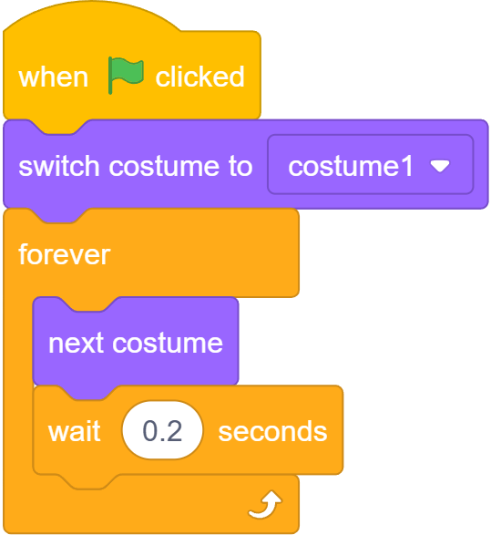

# ساخت انیمیشن در اسکرچ با کاستیوم؛ آموزش قدم‌به‌قدم

برای ساخت انیمیشن در اسکرچ، دو ظاهر متفاوت برای یک شخصیت آماده کن. سپس بلوک «کاستیوم بعدی» را همراه با یک مکث کوتاه داخل حلقه بگذار. با نمایش پشت‌سرهم این ظاهرها، شخصیتت حالت حرکت پیدا می‌کند.

در قسمت ۱۱ آموزش اسکرچ اسکیل‌آپ، ویدیو را رایگان و بدون ثبت‌نام می‌بینی. راهنمای زیر برای تمرین و مرور موضوع کاستیوم نوشته شده و آموزش تکمیلی ویدیو است.

[تماشای ویدیوی قسمت ۱۱ در آپارات](https://www.aparat.com/v/ljc4b3o)

## قبل از شروع چه چیزی لازم داری؟

[ویرایشگر اسکرچ](https://scratch.mit.edu/projects/editor/) را باز کن و یک پروژهٔ تازه بساز. برای این تمرین، انتخاب شخصیت، کشیدن بلوک‌ها و اجرای پروژه با پرچم سبز کافی است. اگر می‌خواهی با نسخهٔ نصب‌شده کار کنی، [راهنمای دانلود اسکرچ اسکیل‌آپ](https://skill-up.ir/magazine/download-scratch) را ببین.

## کاستیوم در اسکرچ چیست؟

کاستیوم (Costume) یکی از ظاهرهای یک شخصیت است؛ مثلاً یک گربه می‌تواند دو حالت متفاوت برای پاهایش داشته باشد. شخصیت یا Sprite کدها و ظاهرهای خودش را دارد. پس‌زمینه یا Backdrop تصویر صحنه است. برای متحرک کردن گربه، لباس‌های همان شخصیت را تغییر می‌دهی.

شخصیت را از فهرست زیر صحنه انتخاب کن و زبانهٔ Costumes را باز کن. اینجا می‌توانی ظاهرهایش را ببینی و ویرایش کنی. دو لباس باید تفاوت قابل‌دیدن داشته باشند؛ کپی کردن یک تصویر بدون تغییر، حرکت قابل‌مشاهده‌ای ایجاد نمی‌کند.

## تفاوت Next Costume و Switch Costume to

بلوک next costume به ظاهر بعدی در فهرست لباس‌های شخصیت می‌رود. برای انتخاب یک ظاهر مشخص، از switch costume to استفاده کن. توضیح عملکرد بلوک اول در [راهنمای رسمی اسکرچ](https://scratch.mit.edu/help/studio/tips/blocks/next-costume/) آمده است.

| بلوک | کاربرد | مثال |
| --- | --- | --- |
| next costume | نمایش ظاهر بعدی به ترتیب فهرست | تکرار حالت‌های پا برای راه رفتن |
| switch costume to | انتخاب یک ظاهر مشخص | شروع پروژه با لباس costume1 |

برای اجرای چرخهٔ لباس‌ها، Next Costume مناسب است. برای تعیین ظاهر شروع یا نشان دادن حالتی مانند خوشحالی، لباس دلخواه را با Switch Costume to انتخاب کن.

## ساخت اولین انیمیشن با دو کاستیوم

### ۱. شخصیت و لباس‌هایش را انتخاب کن

با گربهٔ پیش‌فرض شروع کن. زبانهٔ Costumes را باز کن و روی هر لباس کلیک کن تا تفاوتشان را ببینی. اگر شخصیت دیگری انتخاب کرده‌ای، بررسی کن دست‌کم دو لباس متفاوت داشته باشد.

اگر فقط یک لباس داری، روی تصویر کوچک آن راست‌کلیک و Duplicate را انتخاب کن. در نسخهٔ کپی، حالت دست یا پا را تغییر بده. برای تمرین اول، اندازه و جای کلی بدن را ثابت نگه دار تا نتیجه واضح‌تر باشد.

### ۲. حالت شروع را مشخص کن

به زبانهٔ Code برگرد. بلوک when green flag clicked را قرار بده. زیر آن switch costume to را بگذار و از فهرست، نام لباس اول را انتخاب کن. نام واقعی لباس در پروژهٔ تو ممکن است با مثال فرق داشته باشد.

### ۳. تغییر لباس را تکرار کن

از دستهٔ Control حلقهٔ forever را اضافه کن. داخل حلقه، بلوک next costume از دستهٔ Looks را بگذار. هر بار اجرای این بلوک، لباس بعدی نمایش داده می‌شود.

### ۴. بین لباس‌ها مکث بگذار

بعد از next costume و داخل همان حلقه، wait 0.2 seconds را قرار بده. این مکث فرصت دیدن هر حالت را می‌دهد. تصویر زیر ترتیب اتصال بلوک‌ها را نشان می‌دهد. همین چیدمان را در اسکرچ بساز.

پرچم سبز را بزن. باید تغییر پیوستهٔ لباس‌ها را ببینی. برای توقف، دکمهٔ قرمز توقف کنار پرچم را بزن. در این نمونه، لباس شروع بلافاصله وارد چرخه می‌شود؛ اگر می‌خواهی پیش از حرکت دیده شود، یک wait کوتاه قبل از forever اضافه کن.

### ۵. سرعت را با چشم مقایسه کن

مقدار انتظار را از ۰٫۲ به ۰٫۵ ثانیه تغییر بده و دوباره اجرا کن. با انتظار بیشتر، تغییر لباس آهسته‌تر دیده می‌شود. مقدار مناسب به حالت‌های شخصیت و حرکت موردنظرت بستگی دارد. هر بار فقط همین عدد را تغییر بده تا اثرش را بهتر تشخیص بدهی.

## چطور شخصیت روی صحنه راه برود؟

تغییر لباس، ظاهر شخصیت را عوض می‌کند. برای تغییر موقعیتش، از بلوک‌های دستهٔ Motion هم استفاده کن. در همان حلقه، قبل از next costume یک move 3 steps بگذار. حالا شخصیت هم جابه‌جا می‌شود و هم حالتش تغییر می‌کند.

اگر به لبهٔ صحنه می‌رسد، برای تمرین از if on edge, bounce استفاده کن. اگر بعد از برگشت وارونه شد، حالت چرخش را روی left-right تنظیم کن. ابتدا حرکت لباس‌ها را درست کن و بعد سراغ جابه‌جایی برو؛ پیدا کردن علت خطا ساده‌تر می‌شود.

## رفع اشکال انیمیشن اسکرچ

| مشکل | چه چیزی را بررسی کنی؟ | راه‌حل پیشنهادی |
| --- | --- | --- |
| هیچ تغییری دیده نمی‌شود | تعداد و تفاوت لباس‌های شخصیت انتخاب‌شده | دو لباس متفاوت بساز و next costume را یک بار جداگانه کلیک کن. |
| فقط یک بار لباس عوض می‌شود | جای بلوک نسبت به حلقه | next costume و wait را داخل forever بگذار. |
| تغییرها خیلی سریع‌اند | وجود مکث در حلقه | wait را پس از تغییر لباس اضافه کن و مقدارش را بیشتر کن. |
| شخصیت هنگام تغییر لباس می‌پرد یا می‌لرزد | جای بدن و مرکز لباس‌ها در ویرایشگر | موقعیت و اندازهٔ بدن را بین لباس‌ها هماهنگ کن. |
| لباس‌ها با ترتیب نامناسب پخش می‌شوند | ترتیب تصویرهای کوچک در Costumes | ترتیب لباس‌ها را با کشیدن آن‌ها اصلاح کن. |
| شخصیت روی صحنه جلو نمی‌رود | وجود بلوک حرکت | یک بلوک Motion مانند move به حلقه اضافه کن. |

اگر نتیجه هنوز عجیب است، کدهای دیگری را که هم‌زمان لباس یا موقعیت همین شخصیت را تغییر می‌دهند بررسی کن. برای پیدا کردن مشکل، ابتدا فقط همین برنامهٔ کوتاه را اجرا کن.

## سه تمرین برای ادامهٔ کار

### تمرین اول: یک حرکت خوانا بساز

دو حالت برای دست‌های شخصیت آماده کن. انیمیشن را اجرا کن و بررسی کن تفاوت حالت‌ها دیده می‌شود. بعد لباس شروع را با Switch Costume مشخص کن.

### تمرین دوم: سرعت مناسب را پیدا کن

همان حرکت را با انتظار ۰٫۲ و ۰٫۵ ثانیه اجرا کن. بنویس کدام برای پروژه‌ات بهتر است و چرا. لازم نیست همهٔ حرکت‌ها سریع باشند؛ برای پلک زدن یا تکان دادن دست، زمان‌بندی متفاوتی لازم می‌شود.

### تمرین سوم: لباس سوم اضافه کن

یک حالت میانی بین دو لباس قبلی بساز و ترتیبشان را تنظیم کن. بررسی کن آیا این حالت اضافه، حرکت را واضح‌تر کرده است. تعداد بیشتر لباس به‌تنهایی تضمین نمی‌کند حرکت بهتر شود؛ تفاوت و ترتیب حالت‌ها هم مهم‌اند.

## پروژه‌ات را ذخیره کن

در ویرایشگر، از منوی File گزینهٔ Save to your computer را انتخاب کن تا نسخه‌ای از پروژه روی دستگاهت داشته باشی. برای ادامه، از Load from your computer استفاده کن. نامی مثل «تمرین لباس‌های گربه» کمک می‌کند بعداً فایل را راحت‌تر پیدا کنی.

## پرسش‌های رایج

### با یک کاستیوم هم می‌توان انیمیشن ساخت؟

برای دیدن تغییر ظاهر با Next Costume به دست‌کم دو ظاهر متفاوت نیاز داری. با یک لباس هم می‌توان موقعیت یا اندازهٔ شخصیت را تغییر داد، اما تمرین این صفحه دربارهٔ تغییر لباس است.

### چرا شخصیت هر بار با لباس متفاوت شروع می‌شود؟

قبل از حلقه، Switch Costume to را قرار بده و لباس شروع را انتخاب کن. بررسی کن کد دیگری هم‌زمان آن را تغییر ندهد.

### برای دیدن قسمت ۱۱ باید ثبت‌نام کنم؟

این قسمت در صفحهٔ عمومی اسکیل‌آپ رایگان و بدون ثبت‌نام قابل تماشا است. دسترسی به قسمت‌های قبلی تابع شرایط پنل دوره است.

### این متن، پیاده‌سازی کلمه‌به‌کلمهٔ ویدیو است؟

این متن راهنمای تکمیلی موضوع درس است و برای تمرین، مرور و رفع اشکال نوشته شده است.

تمرینت را اجرا کن و در دیدگاه‌ها بنویس کدام لباس یا کدام بلوک برایت سؤال ایجاد کرده است. نام بلوک و نتیجه‌ای که می‌بینی کمک می‌کند سؤال روشن‌تر باشد.

## منابع و ادامهٔ یادگیری

- [راهنمای رسمی Next Costume در اسکرچ](https://scratch.mit.edu/help/studio/tips/blocks/next-costume/)
- [آموزش Next Costume از بنیاد اسکرچ](https://www.scratchfoundation.org/learn/learning-library/next-costume)
- [راهنمای شروع اسکرچ از Raspberry Pi Foundation](https://projects.raspberrypi.org/en/projects/getting-started-scratch)

## آموزش اسکرچ را ادامه بده

برای ثبت‌نام در دورهٔ کامل اسکرچ، از [صفحهٔ ثبت‌نام اسکیل‌آپ](https://skill-up.ir/signup) شروع کن. تماشای این قسمت رایگان است و به ثبت‌نام نیاز ندارد.
